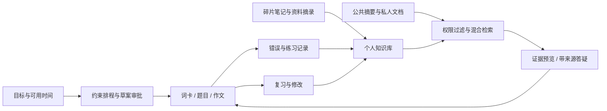
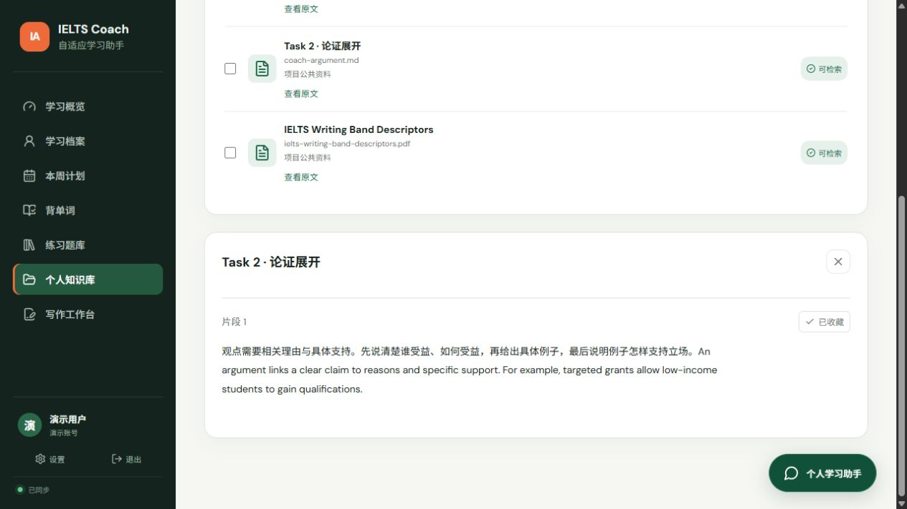
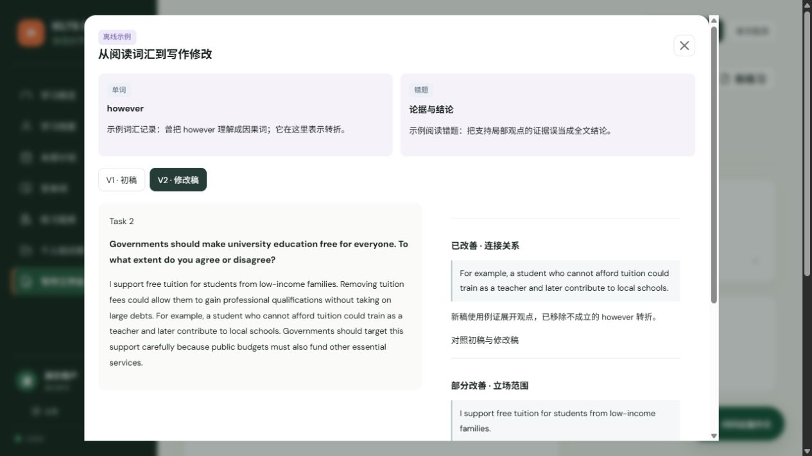

# IELTS Adaptive Coach

面向 IELTS Academic 学习者的个性化学习原型：设置目标与时间、审核学习计划、练习词汇与题目、修改作文，并把错题、写作问题和碎片笔记积累成可检索的个人知识。

**当前完整版本：`ccy最新-20261114`** · [团队仓库](https://github.com/Swordmynew/IELTS-learning-assistant) · [项目入口](START_HERE.md) · [目录结构](PROJECT_STRUCTURE.md)

> 当前可运行的本地验收模式是 SQLite、离线生成与哈希向量。真实生成模型、语义向量质量及生产部署仍待实测。固定离线示例与真实反馈在界面中区分。

## 目录

- [系统闭环](#系统闭环)
- [完整功能清单](#完整功能清单)
- [个性化 RAG 与算法](#个性化-rag-与算法)
- [快速启动](#快速启动)
- [如何使用](#如何使用)
- [模型与部署配置](#模型与部署配置)
- [项目结构与接口](#项目结构与接口)
- [验证记录](#验证记录)
- [六人分工与英文 PPT](#六人分工与英文-ppt)
- [未完成事项](#未完成事项)
- [数据、许可与交接](#数据许可与交接)

## 系统闭环



当前规划采用规则诊断与 OR-Tools，RAG 用于检索、答疑和写作上下文；规划节点里的 retrieve 结果尚未参与任务选择。个人记录用于当前请求的上下文组织，不需要微调模型。

## 完整功能清单

### 1. 账号、用户中心与设置

- 邮箱注册、登录、退出、持久会话选项，以及显式“体验演示”入口。
- 查看个人资料、修改昵称、校验原密码后改密；演示账号密码只读。
- 保存默认起始页、听力语速偏好、紧凑选项及词卡记录展开偏好。
- 后端通过 JWT 身份定位数据库用户；私人资料、学习记录、对话和缓存按用户隔离。

### 2. 学习档案与概览

- 设置考试日期、听说读写当前分与目标分、每日可用分钟、优先科目。
- 显示目标、当前重点、正式计划完成情况和最近写作结果。
- 使用服务端统一学习日期与 `LEARNING_TIMEZONE`；新日期需在未来，过期历史画像仍可读取。
- 保存画像时保留已有学习事实；不将自评或一次练习直接解释成稳定能力提升。

### 3. 周计划、审批与任务

- LangGraph 工作流：`intake → diagnose → retrieve → plan → validate`；SSE 进度来自实际节点执行，运行记录可查询。
- OR-Tools CP-SAT 排程；缺少求解器时提供确定性回退，并继续运行校验。
- 受每日容量、训练要求、高负荷限制与考试日期约束；最多七天，任务最晚在考试前一天。
- 先生成草案，再由用户启用；冲突草案显示原因并禁止审批。
- 画像签名与生成时的正式计划 ID 检查过期草案；画像变化会使旧草案失效。
- 用户级事务串行化和数据库唯一索引限制每用户一份正式计划；同一审批幂等，重复生成支持请求键。
- 标记任务完成、恢复误标任务、从任务跳转对应练习。完成状态不能替代实际作答或成绩证据。

### 4. 词汇学习

- 首次准备生成 8,520 个固定版本 ECDICT 英汉词条；正常翻卡无需词典网络或模型。
- 搜索/浏览词条，先回忆再查看释义，保留个人原句和词汇来源。
- “忘了 / 模糊 / 记住了”复习记录与下次到期安排；到期、新词及个人词卡队列。
- 后端支持词卡编辑、暂停状态、复习版本检查与事件幂等；个人积累不改写共享词表。
- 作文反馈后的独立后台提词：持久任务、单独模型调用、有效空结果、失败重试与来源合并；不阻塞反馈，不伪造词条。
- 保留旧词汇测评与回顾接口用于历史兼容；当前主要页面是背单词。旧 CAT/IRT 的词族估计尚未校准，不作为标准化成绩。

### 5. 题库与错题

- 听力、阅读、写作、口语四科套题按需展开；按科目、题型、关键词筛选。
- 内置 12 道项目原创仿真题；通过表单添加私人题目，保留 JSON/CSV 批量导入接口。
- 客观题由服务端判分，显示参考答案、解析及最近一次作答统计；开放题保留练习材料，不能等同于客观自动评分。
- 错题复习，答对后从待复习集移出；错误与个人知识记录关联，可回到原题。
- 题干、解析等片段可收藏成带原文快照的笔记。

### 6. Task 2 多稿写作

- 保存写作会话、题目和不可变稿件版本，切换初稿与修改稿。
- 模型可用时生成四项写作反馈、原句批注、问题状态及修改前后比较。
- 三层提示“思考 / 方向 / 示例”，以及围绕当前稿件与问题的答疑。
- 问题可积累到个人知识库，并记录后续修改事件；提词任务独立处理。
- 模型失败时保留稿件，尝试当前用户的精确上下文缓存；未命中则显式提示不可用。
- 独立固定原创离线示例展示 V1、提示和 V2，不对新输入作文实时评分，也不计入个人成绩。
- 保留 Task 1/Task 2 单次批改与历史反馈路径；它与新版 Chat Completions 使用独立配置，不能将规则基线当成考官评分。

### 7. 个人知识与碎片收集

- 自动积累可关联的历史词汇错误、题目错误和写作问题；支持历史回填，重复回填不重复计数。
- 手工新建碎片笔记，填写标题、内容、备注、来源和知识点标签。
- 从文档、题目、作文和答疑收藏原文；摘录与自己的备注分开保存。
- 按类别和知识点筛选，查看原始记录、来源与独立学习事件；关联同类错误。
- 编辑、合并、删除知识条目，保留原练习事实；合并后的事件指向保留条目。
- 自评复习与实际作答事件分开统计；“已改善”可降低检索优先级，自评不增加实际错误次数，也不证明掌握。

### 8. 文档与来源核对

- 上传 TXT、Markdown、文本型 PDF，查看摄入状态并建立分块索引；上传与检索均受用户权限约束。
- 文本 PDF 使用 pypdf 按物理页抽取，空白页不会让后续页码重新编号。
- 按页/片段查看原文，鉴权访问原文件，按选中片段收藏，保留文档、页码与原句。
- 同一句出现在不同页时保留所选片段位置；私人文件响应使用 private/no-store 缓存策略。
- 加密、空白、无文字或扫描文件明确报错/提示；解析失败不会把半套索引标为成功。
- DOCX 有可选 Docling 路径，尚未在当前环境验收；扫描件 OCR 尚未实现。

### 9. 个人学习助手与检索

- 跨页面悬浮助手，支持一般学习问题、选定资料范围、稿件上下文与对话历史。
- “查找相关资料”只检索、不调用生成模型；可先核对笔记或资料是否命中。
- 公共摘要、私人文档和个人学习记忆参与候选排序，显示原文、来源及匹配原因。
- 有模型时根据选中证据生成回答并引用来源；离线时显示检索结果和不可用提示，可打开固定示例。
- 上下文受总量、每来源与历史预算限制；规则式追问处理只补有限上下文。
- 编辑、合并、删除及复习更新会影响修订与缓存；生成期间记忆改变时拒绝保存过期的新结果。

### 10. 工程能力与当前范围

- 62 个 HTTP 接口、OpenAPI、Alembic 迁移、测试和 CI 配置。
- 本地 SQLite 已验收；已有 PostgreSQL/pgvector、Redis/RQ 与 Docker 配置，但实际部署仍待验证。
- 统一启动与验证脚本，项目内日志、PID、缓存和隔离预览库。
- 当前数据库 head 为 `0008_plan_approval_guard`。旧 `0012_model_calls` 属于另一迁移链，不能直接混接。

## 个性化 RAG 与算法

| 组件 | 当前做法 | 验证边界 |
| --- | --- | --- |
| 资料摄入 | 解析、分块、保存来源/页码与向量 | 文本 PDF 已做合成样例回归；扫描 OCR 未实现 |
| 访问控制 | 排序前筛选公共及当前用户可见记录 | 跨用户隔离有程序测试；不是独立安全审计 |
| 混合检索 | 向量相似度、英文关键词、中文 bigram 稀疏排序与融合；个人知识叠加知识点、学习状态等信号 | 当前预览向量为 hashing，未发布真实语义准确率 |
| 个性化 | 来源事实、错误/复习事件、标签和关联条目进入上下文 | 规则标签可编辑；尚无经人工样本校准的分类指标 |
| 上下文 | 默认总证据 18,000 字符、每来源 5,000 字符，历史另外限额 | 为字符预算，不声称与某模型 token 上限完全等价 |
| 回答与引用 | 仅允许实际放入请求的来源 ID，保留逐字片段与位置 | ID/原文校验不等于所有回答都已被语义证据充分支持 |
| 缓存 | 用户、上下文、模型/提示配置及知识修订共同定位 | 不跨用户复用，不把旧回答误当新的真实模型调用 |
| 排程 | 规则诊断、任务模板、CP-SAT 与后置校验 | retrieve 目前不驱动任务选择；学习效果优化尚未实测 |

当前 coach 检索走可移植向量/关键词路径；保留的 PostgreSQL FTS/pgvector 帮助函数不代表新路径已经在数据库侧执行。详见 [架构](docs/development/ARCHITECTURE.md) 和 [个性化 RAG](docs/rag/PERSONALIZED_RAG_IMPLEMENTATION.md)。

## 快速启动

### 环境

本机已验证 Python 3.11（现有 Conda `ielts-coach`）和 Node.js 24；仓库要求 Node.js ≥22。先检查已有环境与 `backend/pyproject.toml`，缺包再安装。不要改动 ai-dev 的 AI/CUDA 配套或默认新建 uv/venv。

```powershell
git clone --branch "ccy最新-20261114" https://github.com/Swordmynew/IELTS-learning-assistant.git
cd IELTS-learning-assistant
$IeltsPython = 'D:\Anaconda3\envs\ielts-coach\python.exe'
$env:PYTHONNOUSERSITE = '1'
$env:PYTHONUTF8 = '1'
& $IeltsPython -c "import sys, fastapi, sqlalchemy, ortools, pypdf; print(sys.executable)"
# 确实缺依赖时才执行：
# & $IeltsPython -m pip install -e './backend[dev]'
npm ci --prefix frontend
& $IeltsPython backend/scripts/import_starter_vocabulary.py
.\scripts\start-conda-preview.ps1 -PythonPath $IeltsPython
```

打开 [前端](http://127.0.0.1:3000)，点击“体验演示”。[API 文档](http://127.0.0.1:8000/docs) · [健康检查](http://127.0.0.1:8000/api/v1/health)。

启动脚本强制离线和 hashing，不调用付费模型；自动迁移独立预览库，运行数据保存在 `local-data/runtime/`。端口已占用时直接访问现有服务，或使用 `-BackendOnly` / `-FrontendOnly` 启动缺失的一端。查看 PID 并核对后仅停止本项目服务。

完整依赖准备、故障处理、真实模型启动及维护见 [快速启动](docs/guides/QUICKSTART.md)、[运行维护](docs/guides/OPERATIONS.md)。

## 如何使用

1. **档案**：设定未来考试日期、目标及每天的可用时间。
2. **计划**：生成草案、核对安排后启用；完成或恢复任务。
3. **练习**：翻词卡，做原创客观题，或保存作文稿件。
4. **积累**：查看自动错误记录，补充碎片笔记，收藏原文。
5. **检索**：查找相关资料，核对来源，再使用助手答疑。
6. **修改与复习**：修改作文、查看比较或记录自评；保留事实与来源。





详细操作见 [完整使用指南](docs/guides/USER_GUIDE.md)；课堂脚本见 [演示操作单](docs/presentation/DEMO_RUNBOOK_ZH.md)。

## 模型与部署配置

| 配置 | 用途 |
| --- | --- |
| `COACH_API_KEY` / `COACH_BASE_URL` / `COACH_MODEL` | 多稿写作、提示、个人助手与独立提词 |
| `COACH_OFFLINE` | 是否关闭当前 coach 实时生成；预览启动器始终强制为 true |
| `OPENAI_*` / `LLM_PROVIDER` | 保留的单次 Responses 批改路径，与 COACH 配置独立 |
| `EMBEDDING_PROVIDER` | hashing 演示；fastembed 本地向量；openai 兼容向量接口 |
| `LEARNING_TIMEZONE` | 统一学习日，预览为 Asia/Shanghai |
| `RAG_EVIDENCE_CHARS` / `RAG_SOURCE_CHARS` | 证据字符预算 |
| `DATABASE_URL` / `UPLOAD_DIR` / `JWT_SECRET` | 存储与会话，真实值仅保留在安全的本机环境 |
| `BACKEND_INTERNAL_URL` | Next.js 服务端代理地址 |

真实生成必须单独配置并重启后端，不能靠修改 `.env` 覆盖预览脚本强制值。切换向量模型后需重建文档与个人知识向量。模型请求会包含作文、问题和选中证据，演示先使用无个人信息的合成材料。完整参数见 [.env.example](.env.example)。

## 项目结构与接口

```text
backend/app/routes/    按业务分类的 HTTP 接口
backend/app/services/  规划、RAG、模型、词汇与学习记忆
backend/app/agents/    LangGraph 工作流
backend/alembic/       数据库迁移
backend/tests/         后端测试
frontend/app/          页面与所属组件
frontend/lib/          客户端接口、类型和工具
frontend/tests/        浏览器流程
scripts/              项目级启动与验证
docs/                使用、开发、RAG、验收、展示与历史文档
evals/               检索 smoke 样本
local-data/            本机数据、日志、归档，受 Git 忽略
```

| 功能域 | 接口示例 |
| --- | --- |
| 身份与偏好 | `/api/v1/auth/*`、`/api/v1/settings` |
| 画像与计划 | `/api/v1/diagnostics`、`/api/v1/plans/*`、`/api/v1/tasks/*` |
| 工作流 | `/api/v1/agent/runs/stream`、`/api/v1/agent/runs/{run_id}` |
| 词汇与题库 | `/api/v1/vocabulary/*`、`/api/v1/question-bank/*` |
| 写作 | `/api/v1/writing/sessions`、`/api/v1/writing/versions/*`、`/api/v1/writing/assessments` |
| 个人知识 | `/api/v1/knowledge/items`、`/api/v1/knowledge/topics`、`/api/v1/knowledge/bookmarks` |
| 文档与检索 | `/api/v1/knowledge/documents/*`、`/api/v1/rag/query`、`/api/v1/rag/preview` |

[62 个接口清单](docs/development/API_REFERENCE.md) · [开发交接](docs/development/HANDOVER.md) · [文档导航](docs/README.md)

## 验证记录

2026-11-14 整理验收基线：

| 检查 | 结果 |
| --- | --- |
| 后端功能与迁移回归 | 152 项通过 |
| 浏览器流程 | 20 条通过，其中 14 条模拟接口、6 条真实离线 API |
| Ruff、前端类型、生产构建 | 通过 |
| 原有 API 方法/路径 | 62 对保留 |
| 项目迁移后的启动与健康检查 | 通过 |

这些结果验证程序行为，不表示真人学习增益、评分校准、真实模型质量或生产部署已验证。报告见 [整理验收](docs/validation/REORGANIZATION_2026-11-14.md)、[机器摘要](docs/validation/REORGANIZATION_SUMMARY.json)。

```powershell
.\scripts\verify-local.ps1
# 停止共用 .next 的开发服务后，再运行构建：
.\scripts\verify-local.ps1 -Build
# 先启动隔离预览，再运行浏览器流程：
.\scripts\verify-local.ps1 -Browser
```

## 六人分工与英文 PPT

演示版共18页，用合成用户Alex的实际操作截图串起档案、错题、个人笔记、检索来源、计划审批、词卡和写作修改。截图带本地页面链接，英文标签为展示译注；中文讲稿在演讲者备注。写作V1/V2为固定离线示例，真实生成仍需独立验收。

展示页和 Q&A 展示页全部英文；中文讲稿、操作单和分工说明保留在备注与独立文档。成员 A–F 是待填写的姓名占位，下面是准备/讲解安排，不是对历史开发贡献的认定。

| 成员 | 准备及讲解责任 | PPT 页 | 时间 |
| --- | --- | --- | --- |
| A | 问题、用户场景、价值与开场；统一资料与版本 | 1–3 | 2 分钟 |
| B | 前后端架构、数据来源与操作闭环；核对代码入口 | 4–5 | 2 分钟 |
| C | 个人记忆与 RAG、来源和缓存；准备检索样例 | 6–9 | 3 分钟 |
| D | 排程约束、真实工作流与审批；准备冲突/过期说明 | 10–11 | 2 分钟 |
| E | 统一操作电脑，完成练习、检索与写作现场演示 | 12–15 | 4 分钟 |
| F | 程序验证、价值与局限；计时及问答协调 | 16–17 | 2 分钟 |
| 全员 | 按题目领域回答，A 分配、F 控制时间 | 18（Q&A） | 另留 4 分钟 |

**用户确认方案：15 分钟讲解与演示＋4 分钟 Q&A，共 19 分钟。**

本地 `DSAI5205_Final_Project_Guidance.pdf` 第 1–2 页规定的是 **14＋4 分钟，共 18 分钟**，每位成员需发言并准备回答问题。因此另外提供 14 分钟压缩方案；正式课堂以教师确认的时长执行。存放在 DSAI5206 文件夹不改变这份来源文件标注的课程。

- [六人分工、时间轴与课程对照（中文）](docs/presentation/PRESENTATION_PLAN_ZH.md)
- [英文 PPT 逐页内容与中文讲稿](docs/presentation/SLIDE_OUTLINE.md)
- [课堂操作单与故障回退（中文）](docs/presentation/DEMO_RUNBOOK_ZH.md)
- [问答准备：英文回答、中文提示](docs/presentation/QA_BANK.md)
- [英文展示 PPT，中文演讲者备注](docs/presentation/Group20.pptx)

## 未完成事项

| 事项 | 当前状态 / 接手动作 |
| --- | --- |
| 真实生成与语义向量闭环 | 代码存在，尚未实际验收；配置供应商并使用合成输入逐项验证 |
| 授权语料与真人评测 | 补充授权文本、人工评分作文、检索人工复核集；smoke 集不能充当质量指标 |
| 旧版兼容移植 | 限时练习、分次记录、重排、材料引用保护、机构 OIDC 和旧限流等仍待设计兼容迁移 |
| 外部服务与部署 | PostgreSQL、Redis/RQ、Docker、备份恢复、公网运行均需实际验证 |
| 后续候选 | OCR、独立重排序、数据库侧检索、经校准的微练习及语音评分 |
| 课程报告与贡献表 | 报告、真实贡献和成员姓名需小组确认；README 与演示安排不能替代报告 |

当前无已验证的 RAG 准确率、人工评分一致率、真人学习提升或模型成本/延迟结果；这些指标留待真实测量。

## 数据、许可与交接

- 项目沿用 [MIT 许可](LICENSE)；ECDICT 使用固定版本与 [上游 MIT 许可](backend/app/data/vocabulary/LICENSE.ecdict.txt)。词库由脚本生成，不提交原始下载或个人进度。
- 公共评分资料为短篇释义与原链接，内置题目和离线例子为项目原创仿真，不分发商业题库。
- `.env`、数据库、上传材料、JWT 密钥、依赖、缓存与 `local-data` 不上传 GitHub；网页上传不会替你执行 `.gitignore`。
- 旧目录已移除，旧独有代码/资料在本机 `local-data/legacy-project.zip` 校验归档；旧 0012 库只归档，不接入当前 0008。
- 新分支保留原 main 与 feature 的 Git 历史，原团队分支和个人仓库此前交付不被覆盖。

接手按 [START_HERE](START_HERE.md) → [QUICKSTART](docs/guides/QUICKSTART.md) → [HANDOVER](docs/development/HANDOVER.md) 阅读。
