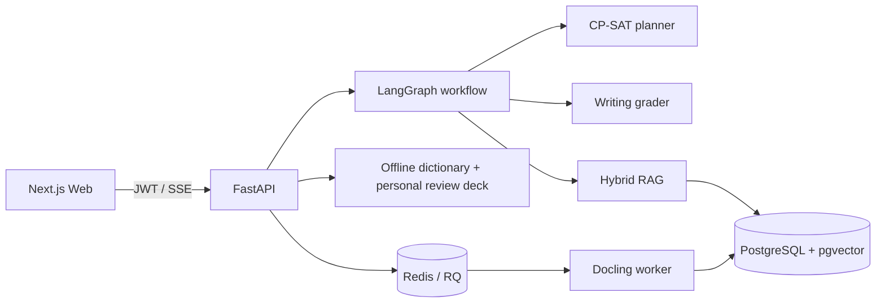

# IELTS Adaptive Coach

面向中国 IELTS Academic 考生的自适应学习规划与写作反馈系统。项目将学习目标、时间约束和练习表现转换成可审核的周计划，并使用带来源引用的 IELTS 官方评分标准生成写作反馈。


## 已实现

- Task 2 多稿写作工作台：初稿、修改稿、逐项复评与三层提示，支持 DeepSeek Chat Completions。
- 跨科目个人知识库：自动积累错词、错题和写作问题；无需逐条确认，支持编辑、合并、删除及历史回填。
- 公共依据、私人笔记和个人学习记录共同参与 RAG 答疑；引用可回到资料、原题和作文版本。
- 模型失败时回放当前用户的匹配缓存；未命中则提供独立离线示例，不计入学习记录。

新版的本地运行、配置与课程展示步骤见 [docs/COACH_DEMO.md](docs/COACH_DEMO.md)。

- 完整的邮箱注册/登录、可选持久会话、退出登录、用户中心、改密和一键演示账号；所有业务查询按用户隔离。
- LangGraph 显式规划工作流：`intake → diagnose → retrieve → plan → validate`。
- OR-Tools CP-SAT 周计划器，以及缺少 OR-Tools 时的确定性降级方案。
- 草案/批准/废弃状态，未批准计划不会替换正式日程。
- OpenAI Responses API JSON Schema 写作评估，并兼容 DeepSeek Responses API；无密钥时使用明确标记的离线规则基线。
- 四项写作标准、作文原文证据位置、官方评分标准链接和置信度。
- 背单词：环境准备时下载生成 8,520 个 ECDICT 英汉词条，结合个人错词与作文积累，支持离线翻卡、原句回顾和间隔复习。
- 作文批改后独立后台提词；支持主动积累、空列表、来源合并与失败重试，不阻塞原有反馈。
- Docling 文档摄入、Redis/RQ 后台任务、上传大小和扩展名限制。
- 可编辑的考试日期、四科当前/目标分数、每日可用时间和优先科目画像。
- 周计划按到期词卡和个人积累安排词汇复习任务。
- 分页式学习工作台、四科套题浏览、表单化私人题目录入及按需显示答案解析。
- 服务端客观题判分、最近作答统计、错题复习和答对后自动移出错题集。
- 本地多语言 FastEmbed + PostgreSQL 全文检索 + pgvector + RRF；SQLite 开发环境使用可移植混合检索。
- Next.js Dashboard、用户中心、学习偏好、能力雷达图、计划审批、任务完成和写作实验室。
- Alembic、Docker Compose、GitHub Actions 和核心算法测试。

## 架构



更完整的边界与数据流见 [docs/ARCHITECTURE.md](docs/ARCHITECTURE.md)。

## 快速开始

### Docker Compose（推荐）

1. 复制 `.env.example` 为 `.env`，至少修改 `JWT_SECRET`。
2. Task 2 多稿写作、个人助手和作文提词使用 `COACH_API_KEY`（例如 DeepSeek），配置见下文。`OPENAI_API_KEY` 仅用于保留的单次批改接口。词卡学习不需要 API 密钥。
3. 启动：

```bash
docker compose up --build
```

后端镜像构建时自动准备固定版本的离线词库，需要联网访问 ECDICT；运行时不再下载词库。

- Web：<http://localhost:3000>
- OpenAPI：<http://localhost:8000/docs>
- Health：<http://localhost:8000/api/v1/health>

### 不使用 Docker

需要 Python 3.11–3.14、Node.js 22 或更新的兼容版本及 npm。以下为 Windows PowerShell 命令，从仓库根目录开始：

```powershell
# 已有 .env 时保留原文件，只补充 .env.example 中的新配置。
if (-not (Test-Path .env)) { Copy-Item .env.example .env }

cd backend
python -m venv .venv
.\.venv\Scripts\python.exe -m pip install -e ".[dev]"
.\.venv\Scripts\python.exe -m alembic upgrade head
cd ..

# 环境资源准备：首次下载词库，再次运行会复用已有文件。
# 根目录没有 npm 依赖，不需要在根目录运行 npm install。
npm run setup:vocabulary

cd frontend
npm ci
cd ..
```

编辑根目录 `.env`：设置随机的 `JWT_SECRET`，并按下文配置 `COACH_*`。本地默认使用 SQLite，数据库位于 `backend/ielts_coach.db`；`.[dev]` 安装包含所需的 SQLite 驱动。启动两端：

```powershell
.\scripts\start-local.ps1
# 后端代码或 .env 修改后：
.\scripts\start-local.ps1 -Restart
```

打开 <http://localhost:3000>。脚本使用 `backend/.venv`，在后台启动 API 和前端开发服务，日志写入忽略的 `tmp/`。也可在两个终端手动启动（macOS/Linux 使用 `.venv/bin/python`）：

```powershell
# 终端一，从仓库根目录开始
cd backend
.\.venv\Scripts\python.exe -m uvicorn app.main:app --reload --host 127.0.0.1 --port 8000

# 终端二，从仓库根目录开始
cd frontend
npm run dev
```

本地词卡、作文提词后台任务和 TXT/Markdown 摄入不依赖 Docker 或 Redis。PDF/DOCX 解析需要在 `backend/` 额外执行 `.\.venv\Scripts\python.exe -m pip install -e ".[documents]"`。

### 离线词库与首次联网

**克隆后先在仓库根目录运行 `npm run setup:vocabulary`。** 词库作为环境资源下载生成，不提交到 Git。该命令优先使用 `backend/.venv` 的 Python，也可使用系统 Python；下载固定 ECDICT 版本、校验 SHA-256，再生成 `backend/app/data/vocabulary/starter.json`。已有同版本词库时直接复用。

| 文件 / 资源 | 用途与准备方式 |
|---|---|
| `starter.json` | 8,520 个 ECDICT 英汉词条，约 2.3 MB；由 setup 命令生成，后端运行时直接读取。 |
| `LICENSE.ecdict.txt` | 仓库保留上游 MIT 许可，分发生成词库时须一并保留。 |
| FastEmbed 向量模型 | 与词库不同，首次语义检索需要联网下载；默认缓存于 `backend/.cache/fastembed`。 |
| DeepSeek API | 新作文批改、提词和助手实时回答需要网络及 `COACH_API_KEY`；离线翻卡、释义和复习无需模型调用。 |

原始词库 CSV 缓存于忽略的 `tmp/`，生成词库也在 `.gitignore` 中。`npm run setup:vocabulary -- --force` 可从缓存重建；缺少下载缓存时需要联网。来源版本、哈希和选词规则见 [词汇学习说明](docs/VOCABULARY_LEARNING.md)。个人新增词汇、原句和复习进度保存在数据库中，不改写共享词库；备份个人数据时保留数据库即可，词库可重新生成。

完全离线演示可设置 `COACH_OFFLINE=true`：AI 请求只回放当前用户的匹配缓存，未命中时可打开独立“离线示例”，不生成当前作文的反馈或词汇。应先联网安装 Python/npm 依赖、准备词库及向量模型缓存，再断网运行。

题库与检索资料采用两条不同的数据管线：PDF/DOCX/TXT/MD 在“学习资料”页面建立检索索引；可直接练习和展示的题目在“练习题库 → 录入新题”中使用普通表单逐题录入。后端仍保留 JSON/CSV 批量导入接口供管理员或开发者使用，模板位于 `frontend/public/question-bank-template.json`，单次最多导入 500 题。内置题目均为项目原创仿真练习，不包含商业题库内容。

前端按职责拆分为登录/注册、学习概览、用户中心、设置、学习档案、本周计划、背单词、练习题库、学习资料和写作反馈。首次访问会进入登录页，不再自动使用共享演示数据；仍可显式选择演示账号。开发环境默认通过 Next.js 的 `/api` 同源转发访问后端，避免额外配置跨端口请求；部署时可用 `NEXT_PUBLIC_API_URL` 覆盖。

### 模型供应商

新版 Task 2 工作台和个人知识库使用独立的 Chat Completions 配置。DeepSeek 示例：

```env
COACH_API_KEY=your-deepseek-key
COACH_BASE_URL=https://api.deepseek.com
COACH_MODEL=deepseek-chat
COACH_MAX_OUTPUT_TOKENS=6000
COACH_OFFLINE=false
VOCABULARY_WORKER_ENABLED=true
EMBEDDING_PROVIDER=fastembed
```

`COACH_MODEL` 应填写账号实际支持的模型 ID。密钥仅存于后端 `.env`。向量模型在本地运行，不使用 DeepSeek 生成向量。修改配置后需重启 API；首次从 hashing 演示模式切换到 FastEmbed 后，运行 `backend/scripts/reembed_knowledge.py` 重建资料及个人知识向量。

`.env` 放在仓库根目录，后端会自动读取；工作目录下 `.env` 的同名配置和系统环境变量可覆盖它。密钥不要放进 `NEXT_PUBLIC_*`。`VOCABULARY_WORKER_ENABLED=true` 启用 API 进程内的后台提词处理。前端默认通过 `/api` 代理访问 `127.0.0.1:8000`；后端换地址时，在启动前端的环境中设置 `BACKEND_INTERNAL_URL`（根目录 `.env` 不会自动成为 Next.js 的环境配置）。

下方配置属于保留的单次写作接口（包括 Task 1），使用 Responses API；它与新版 `COACH_*` 配置相互独立。只有服务商确实支持该接口时才配置兼容地址。

保留接口使用 `OPENAI_API_KEY`、可选的 `OPENAI_BASE_URL` 和服务商提供的准确模型 ID：

```env
OPENAI_API_KEY=your-responses-provider-key
OPENAI_BASE_URL=
OPENAI_MODEL=gpt-5.4-mini
OPENAI_REASONING_EFFORT=none
LLM_PROVIDER=openai_compatible
EMBEDDING_PROVIDER=fastembed
LOCAL_EMBEDDING_MODEL=sentence-transformers/paraphrase-multilingual-MiniLM-L12-v2
```

RAG 使用本地 `paraphrase-multilingual-MiniLM-L12-v2`，首次使用会下载模型，之后从 `FASTEMBED_CACHE_PATH` 读取。向量统一为 384 维。若本地模型暂时不可用，系统会记录警告并标记为 `hashing-demo-fallback`；该模式只能用于功能演示，不能作为语义检索评测结果。

也可另配兼容 OpenAI Embeddings API 的服务：设置 `EMBEDDING_PROVIDER=openai`、`EMBEDDING_API_KEY`、`EMBEDDING_BASE_URL` 与 `OPENAI_EMBEDDING_MODEL`；接口必须支持请求 384 维输出。

真实模型烟雾测试只发送仓库内置的无个人信息示例作文，并且不会打印密钥：

```bash
cd backend
.venv/Scripts/python scripts/smoke_live_model.py
.venv/Scripts/python scripts/smoke_local_embedding.py
```

切换 embedding 模型或向量维度后，需重算已有知识块（向量是可再生的派生数据）：

```bash
cd backend
.venv/Scripts/python scripts/reembed_knowledge.py
```

## 关键接口

| 方法 | 路径 | 作用 |
|---|---|---|
| `POST` | `/api/v1/auth/register` | 注册并取得 JWT |
| `POST` | `/api/v1/auth/login` | 邮箱密码登录 |
| `POST` | `/api/v1/auth/demo` | 创建/进入演示空间 |
| `GET/PATCH` | `/api/v1/auth/me` | 查看或修改当前账号资料 |
| `POST` | `/api/v1/auth/change-password` | 校验当前密码后修改密码 |
| `GET/PUT` | `/api/v1/settings` | 读取或保存学习偏好 |
| `POST` | `/api/v1/diagnostics` | 保存四科能力画像与时间约束 |
| `POST` | `/api/v1/plans/generate` | 运行 Agent，生成未批准草案 |
| `POST` | `/api/v1/plans/{id}/approve` | 人工确认并替换旧计划 |
| `GET` | `/api/v1/plans/today` | 获取今日正式任务 |
| `POST` | `/api/v1/tasks/{id}/complete` | 标记正式计划任务完成 |
| `POST` | `/api/v1/tasks/{id}/restore` | 将误标完成的任务恢复为待完成 |
| `POST` | `/api/v1/writing/assessments` | 返回结构化写作估分、证据和引用 |
| `GET` | `/api/v1/vocabulary/deck` | 查询本地词库、个人词汇和复习统计 |
| `GET` | `/api/v1/vocabulary/study` | 生成本次复习队列 |
| `POST` | `/api/v1/vocabulary/reviews` | 保存单词回忆结果和复习进度 |
| `GET/POST` | `/api/v1/vocabulary/extractions` | 查看或请求独立作文提词任务 |
| `POST` | `/api/v1/knowledge/documents` | 上传用户私有资料并排队解析 |
| `GET` | `/api/v1/knowledge/documents` | 查看公共及当前用户的私人资料状态 |
| `POST` | `/api/v1/question-bank/import` | 导入 JSON/CSV 私人结构化题库 |
| `POST` | `/api/v1/question-bank/questions` | 通过普通表单新增一题到私人题库 |
| `POST` | `/api/v1/question-bank/questions/{id}/attempts` | 提交答案并返回判分与解析 |
| `GET` | `/api/v1/question-bank/progress` | 查询题库练习正确率和四科进度 |
| `GET` | `/api/v1/question-bank/questions` | 按科目和题干搜索可访问题目 |
| `POST` | `/api/v1/rag/query` | 执行用户隔离的混合检索 |
| `POST` | `/api/v1/agent/runs/stream` | 查看工作流 SSE 进度事件 |

生成计划支持 `Idempotency-Key`，重复请求会返回同一份计划。

## 验证

```bash
cd backend
ruff check app tests
pytest

cd ../frontend
npm run typecheck
npm run build
```

检索评测采用 `evals/retrieval_gold.jsonl`。当前文件是可执行的小型 smoke 集，不冒充计划中的 100 条人工金标准；扩充方法、验收阈值和结果填写规则见 [docs/EVALUATION.md](docs/EVALUATION.md)。

## 安全与数据边界

- API 从 JWT `sub` 获取用户身份，不接受请求体传入的 `user_id`。
- 私有知识块检索始终添加 `owner_id IS NULL OR owner_id = current_user` 条件。
- 上传文件不会作为系统指令；生成提示词将知识块视为不可信证据。
- 模型调用设置 `store=false`，密钥只存在后端环境变量。
- 内置内容是对官方公开评分维度的短篇释义与原始链接，不复制商业题库。
- 当前初始词库来自 MIT 许可的 ECDICT，来源和选词规则见 [VOCABULARY_LEARNING.md](docs/VOCABULARY_LEARNING.md)；旧词汇测评题目与干扰项由项目自行编写，保留用于历史记录兼容。

详细政策见 [docs/DATA_POLICY.md](docs/DATA_POLICY.md)。

## 仍需完成的作品集里程碑

以下是长期作品集目标，并非 `Guidance.md` 的课程交付门槛。课程版以可交互的 RAG 学习闭环和固定场景验证为主，不需要大型对比实验。

- 将 retrieval gold set 扩展到至少 100 条双人复核问题。
- 用公开或明确授权、带人评标签的作文校准模型，报告 MAE 和 ±0.5 band 一致率。
- 收集经同意的匿名词汇测试作答，进行题目拟合、DIF 公平性分析和外部效度验证；标定前词汇量范围始终显示为实验结果。
- 增加 Playwright 端到端测试、速率限制和托管 Auth/JWKS 验证。
- 真实部署后补充截图、2–3 分钟演示视频、延迟/成本指标和公网地址。

在这些指标实际测量前，README 和简历中不得填写虚构数据。

## 历史词汇测试方法（兼容接口）

当前产品入口为背单词，不再发起词汇水平测试。以下仅说明仍保留的旧测评接口和历史记录。

测评界面参考 [Nation 与 Beglar 的 Vocabulary Size Test](https://openaccess.wgtn.ac.nz/articles/journal_contribution/A_vocabulary_size_test/12552197) 的词义选择思路，
每题提供四个中文释义和“以上都不是”；自适应部分采用 IRT/CAT。当前实现使用五选一猜测参数 `c=0.2`、标准正态先验下的
EAP 能力估计，以及 Fisher information 最大化选题。达到 15 题且标准误不高于 0.45 时提前停止，
否则最多 20 题。词族范围只是待校准映射；完成真实样本标定前，不能把它宣传为标准化测量。

结果采用 CEFR A1、A2、B1、B2、C1、C2 六级作为易读的参考标签。CEFR 官方提供的是语言运用能力描述，不规定各等级对应的固定词汇数量；本项目显示的词族区间是待标定的工程估计，不能作为 CEFR 或 IELTS 官方换算。[Council of Europe CEFR descriptors](https://www.coe.int/en/web/common-european-framework-reference-languages/cefr-descriptors)、[English Vocabulary Profile](https://englishprofile.org/)
