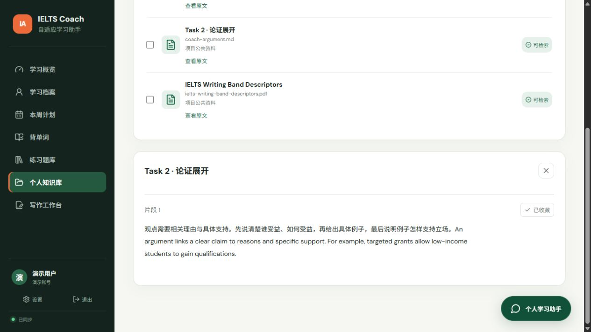
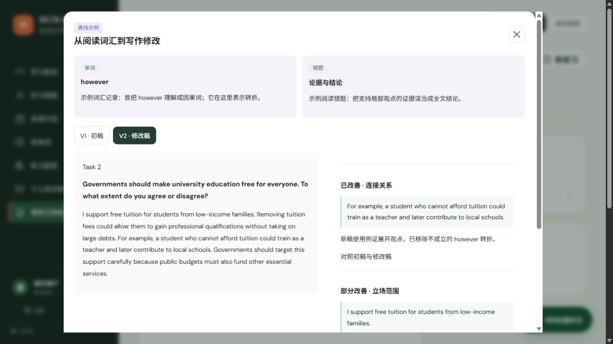
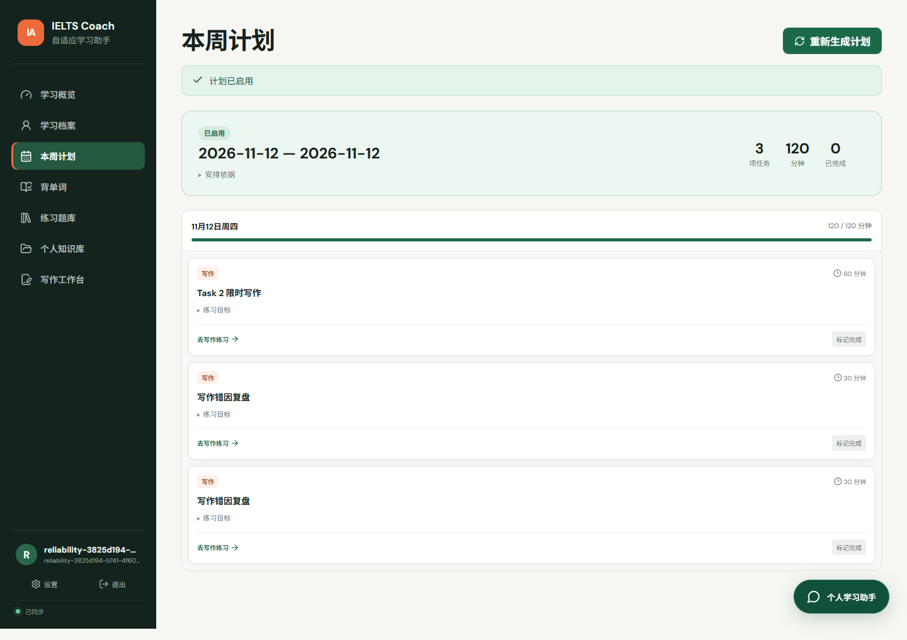
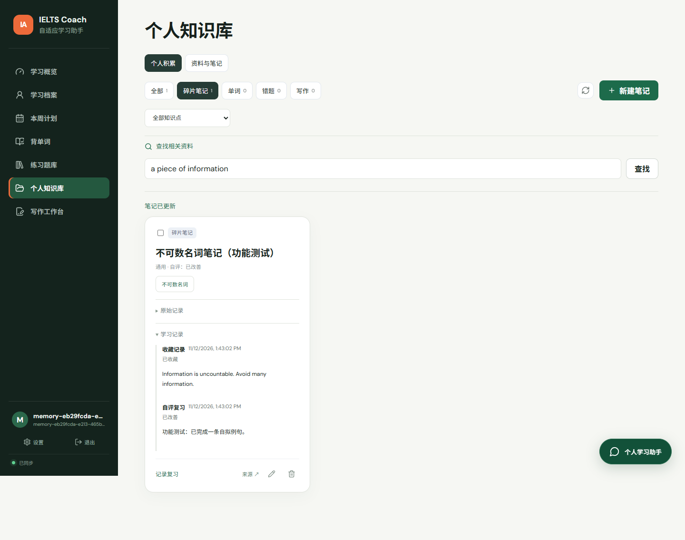

# 5–10 分钟完整系统演示

## 准备

按 QUICKSTART 启动，打开首页并点击“体验演示”。使用演示账号和明确标为“演示”的笔记，不输入私人敏感内容。离线预览无需模型密钥；以下不把固定示例当作真实批改。

## 操作顺序与观察点

1. **概览与档案（1 分钟）**：查看目标和完成情况；进入“学习档案”，讲解考试日期、四科目标、每日时间及优先科目。演示账号已有初始档案；保存修改会影响计划。
2. **生成计划（1 分钟）**：进入“本周计划”，点击生成，观察实际节点进度；先查看草案，再点击启用。标记一项完成并恢复。讲解考前截止、每日容量与人工审批；不要用时间不足的冲突草案演示成功启用。
3. **背单词（1 分钟）**：进入基础词库开始学习，先回忆再翻卡，查看释义和原句，选择复习结果。说明个人词卡与间隔复习。
4. **题目练习（1 分钟）**：展开一组题目并作答。若想展示自动错题积累，可明确说明这是故意答错的演示；查看答案解析，然后从知识库回到原题。练习中的收藏保留原文。
5. **个人知识库（2 分钟）**：新建“演示：information 的数量表达”；内容填写“错误示例 many information；修改为 much information / a piece of information”；标签为“不可数名词”。用“查找相关资料”检索 information，打开片段、匹配原因与来源。记录一次自评，展开学习记录；说明自评不增加实际错误次数。
6. **资料与 PDF（1 分钟）**：上传自己的文本型 PDF/TXT，等待可检索，查看原文并切换页码，收藏一段。说明原文件访问需当前用户权限，扫描件需 OCR。
7. **写作工作台（1–2 分钟）**：打开“离线示例”，依次看初稿、提示、修改稿和对照。配置真实模型后可提交自己的题目/作文并多稿修改；当前离线模式只演示结构和保存，不声称已真实评分。
8. **个人助手与总结（1 分钟）**：打开悬浮助手说明当前页面/资料范围；离线时可以查看检索与固定示例。真实模型模式会结合选中来源、个人记录与当前问题回答。回顾“目标 → 练习 → 积累 → 检索 → 再练习”。

## 如何解释技术

- Next.js 提供交互，FastAPI 提供鉴权、业务与存储。
- OR-Tools 排程受硬约束限制；LangGraph 节点的进度来自实际执行。
- RAG 在推理时检索资料与个人记忆，不需要训练模型；关键词、向量、知识点及学习状态共同影响候选。
- 回答引用与原文收藏有程序校验，真实语义质量仍需人工样本评测。
- 规划 retrieve 尚未影响排程，不展示为 RAG 驱动规划。

## 常见情况

- 登录失效：重新“体验演示”，数据仍保留。
- 看不到 8,520 词：先运行固定版本词库导入脚本。
- 新作文没有反馈：当前是离线模式，查看离线示例；不要把它当成模型对新作文的输出。
- 草案无法启用：档案/正式计划变化或时间不足，需要重新生成或调整时间。
- PDF 失败：检查是否文本型、未加密、未超过上传限制。

## 2026-11-12 本次实际操作

已通过可见浏览器进入本地演示账号，查看档案，生成并启用 11 月 12–18 日的 10 项任务（320 分钟），标记并恢复一项任务；学习 hall 的释义并记录一次“模糊”复习。随后故意将阅读第一题选为 True，看到 False 的解析及个人知识库新增 1 次错误记录。

检索 information 命中已有演示笔记，展开后显示原文、匹配原因和来源。打开公共“Task 2 · 论证展开”片段，保存“演示收藏：Task 2 论证展开”，保留原文并填写独立备注。最后查看固定写作示例的 V1、提示方向和 V2，向个人助手询问“怎样展开 Task 2 的论据？”，看到明确的离线提示及包含刚收藏笔记的来源列表。此次未上传新文件、未调用真实生成模型；PDF 页码另有此前专项回归与截图。

演示数据仅留在被忽略的本机预览库。其他电脑点击演示入口会初始化自己的演示空间；按上面步骤即可复现。截图随源码提供。

## 其他专项截图

下图来自自动化操作的合成场景，供理解界面；不是实际学习效果实验。

