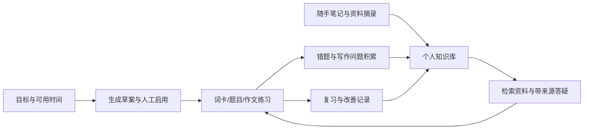

# 完整功能与使用指南

## 1. 系统如何协同

界面与存储会按用户隔离。演示账号适合体验；个人真实学习建议使用自己的账号。演示账号中人工添加的样例不代表实际学习研究数据。

## 2. 页面与能力

| 页面 | 可以做什么 | 说明 |
| --- | --- | --- |
| 学习概览 | 查看目标、当前正式计划、完成情况与最近反馈 | 日期使用服务端学习日期 |
| 学习档案 | 设置考试日期、四科当前/目标分、每天时间和优先科目 | 新输入考试日期须在未来；历史画像仍可查看 |
| 本周计划 | 生成草案、查看真实节点进度、启用、标记/恢复任务 | 任务最多七天，最晚考试前一天；不足会显示冲突 |
| 背单词 | 基础词库翻卡、释义、回顾原句、间隔复习、个人词卡 | 8,520 词需初始化；当前主页面不是词汇量测评 |
| 练习题库 | 浏览四科材料、录入私人题目、客观题判分和错题复习 | 写作/口语等开放题不能当作客观题自动判分 |
| 写作工作台 | 保存 Task 2 多版本、反馈、问题批注、修改比较、三层提示、相关提问 | 新反馈和后台提词需要真实模型或匹配缓存；固定示例可离线查看 |
| 个人知识库 | 自动积累错误，手记笔记、收藏原文、按知识点关联、编辑/合并/删除、自评复习 | 原始证据与备注分开；自评不算客观作答或掌握证明 |
| 资料与笔记 | 上传 TXT/MD/文本型 PDF，查看片段与页码、收藏、选择助手检索范围 | PDF 扫描件需要 OCR；DOCX 依赖可选组件，未在本机验收 |
| 个人学习助手 | 根据资料、个人笔记与学习记录答疑，显示引用 | 离线可查看检索结果/示例；真实生成需模型配置 |
| 用户中心/设置 | 个人资料、密码和偏好管理 | 不应把演示账号用于正式隐私数据 |

## 3. 规划的规则

流程为读取目标、诊断差距、读取评分参考、排程、校验。草案不会直接替换正式计划，需要点击“启用计划”。审批时核对当前画像与生成时的正式计划。修改档案会使旧草案失效；考试日期/时间改变也会停用已不适用的正式计划。

同一草案重复启用幂等。多个旧草案竞争时保持单一正式计划。冲突草案需要调整档案后重新生成。规划中的 retrieve 参考尚未用于任务选择，因此不称为 RAG 驱动排程。

## 4. 个性化 RAG 如何使用

做错的题目、历史词义错误和作文反馈可积累为个人记录。不同练习的同类错误可通过知识点关联。随手笔记可添加标签、来源与相关记录；题目、作文和答疑中的“收藏”保留原文快照。

“查找相关资料”只检索，不调用生成模型，适合先检查资料是否进入知识库。检索结合向量、关键词、知识点、关联记录和复习状态；重复回填不重复计数。规则式标签与追问处理可编辑、可验证，尚不代表经真实样本校准的分类准确率。

启用模型后，助手使用选中的证据生成回答并引用来源。引用 ID、原文收藏与权限有程序校验；句句得到充分语义支持仍需人工评测。用户笔记、AI 答疑摘录与官方标准摘要保留不同身份。

编辑/删除/合并后对应缓存和旧回答上下文会失效。已改善问题可降低提示优先级；一次答对或自评不会宣称稳定掌握。证据与历史受字符预算约束，独立新问题不会无差别拼入旧问题。

## 5. 写作使用步骤

输入 Task 2 题目和作文，提交并保留稿件。模型可用时查看四项反馈和原句批注，先尝试修改，再逐级查看提示。提交修改稿后比较前后证据和问题状态。后台提词独立运行，失败可重试，不伪造词条。

离线时可以保存稿件并打开“离线示例”理解工作台。示例是固定原创内容，不是对刚输入作文的真实批改，也不计入个人成绩。

## 6. PDF 与引用

上传文本型 PDF 后等待“可检索”，点击“查看原文”。选择页码可核对片段；“查看原文件”通过当前用户权限读取文件。收藏绑定所选片段，保留原页码，重复句子出现在不同页时也区分位置。

空白页不会导致后续页码重排；加密文件需先解密；无文字/扫描页明确提示 OCR。解析或向量失败时不会将半套索引标为完成。

## 7. 当前边界

真实模型、真实语义检索和评分质量未在本机验收；本地演示是 SQLite、离线生成和哈希向量。没有独立语音评分、OCR、自动网页采集、经校准的微练习出题器；旧目录的限时练习、分次记录和重排等尚未完全整合。部署与人工评测任务见交接文档。
