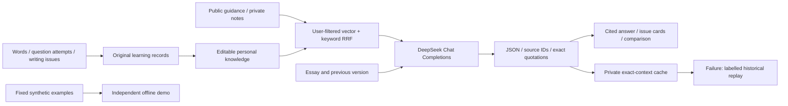
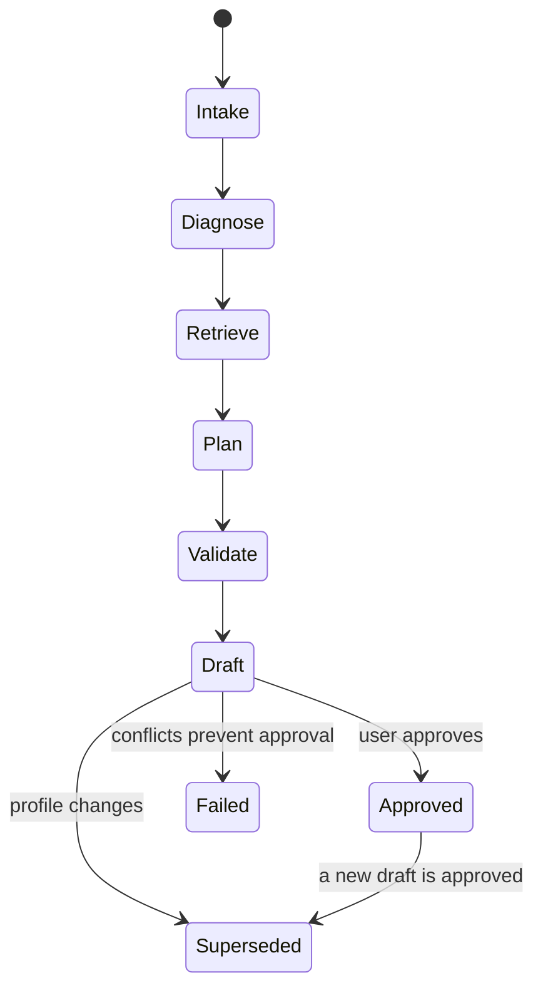
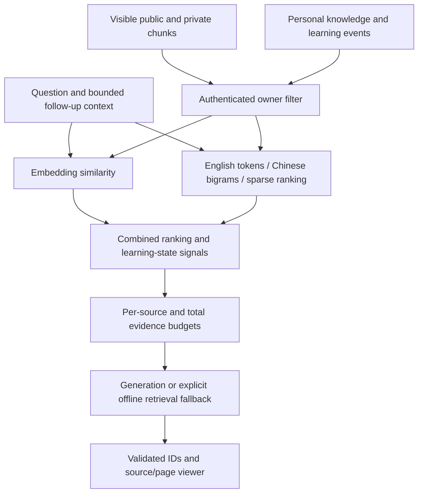
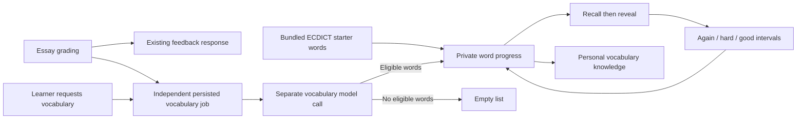

# Architecture decision record

## Context and boundaries

Writing and adaptive planning are the deepest paths. The current course build also supports objective question practice and personal knowledge accumulated across subjects. Task 2 supports immutable draft versions, structured issues, progressive hints and revision comparison; Task 1 retains the original single-assessment path.

## Personal learning RAG and revision coaching

`coach_records` stores typed payloads for personal knowledge, practices, immutable essay versions, conversations and validated caches. Its indexed user/kind/parent fields and unique user/kind/source key support scoped queries and idempotent backfill. Original practice rows remain the source of truth; knowledge vectors can be regenerated. Merge tombstones redirect later learning events into the surviving entry without resurrecting deleted cards.

The shared generation adapter uses `COACH_*` configuration independently of the legacy Responses adapter. It never silently substitutes a heuristic estimate for a failed live request. An exact-context cache includes the user's knowledge revision and model/prompt/schema configuration. Cache misses preserve submitted work and expose a separate fixed demo. Cache and demo modes are visible in the UI.

Personal records carry source links, category, subject, timestamps and concise provenance. They inform cross-subject learning advice but cannot replace public writing-rubric authority. The model sees only the selected evidence within the configured total/per-source character budgets; citation cards retain exact contiguous excerpts and source links. Citation IDs are restricted to evidence actually included in the request. Portable vector/keyword ranking is used on SQLite and PostgreSQL for this course-sized corpus; older PostgreSQL FTS helpers are retained but are not used by the new path. Model changes require re-embedding both document and personal vectors.

The vocabulary diagnostic is a separate measurement path. It does not convert an uncalibrated vocabulary result directly into an IELTS band, because that relationship has not yet been established with validation data.

The system treats three data classes differently:

1. Public knowledge: short paraphrases and links to official IELTS resources.
2. Private knowledge: documents uploaded by one authenticated user.
3. Commercial materials: never bundled, scraped or redistributed.

## Planning workflow

The current planning graph uses deterministic diagnosis and task templates rather than a language-model planning call. CP-SAT owns daily capacity, required weekly sessions and high-load limits. `validate_plan` is run after every solver result, including the deterministic fallback.

Plans stop before the exam date and span at most seven days. Stored profile signatures and base-plan IDs detect stale drafts; user-level transaction serialization plus a partial unique index enforce one approved plan per user. The database transition from `draft` to `approved` is the human-in-the-loop boundary. It is intentionally outside the model turn: approval can be audited, retried with an idempotency key, and cannot be fabricated by generated text.

## Retrieval flow

The new coach path uses portable vector/keyword ranking on SQLite and PostgreSQL; the older PostgreSQL FTS/pgvector helpers remain separate and are not the current coach execution path. Database-side retrieval and an independent reranker are future candidates. Do not report their evaluation results before measuring them.

The default semantic embedding configuration is local multilingual FastEmbed, with 384-dimensional vectors. The verified local preview explicitly uses hashing for deterministic demos. Semantic quality, PostgreSQL performance and real-provider generation remain unverified. Switching embedding models requires re-embedding both document and personal vectors.

Follow-up queries use bounded conversation context; independent questions are not indiscriminately appended to earlier ones. Configured limits bound history and evidence. Editing/merging/deleting personal knowledge advances its revision, invalidates matching caches, and marks historical contexts stale; a generation-time revision guard rejects stale new results.

Text PDFs use pypdf and preserve physical page numbers, including gaps from blank pages. Scans require OCR. Chunk and original-file routes check authenticated ownership; source bookmarks preserve the selected chunk/page and the original quote separately from the learner note. Private file responses use private/no-store cache headers.

Metadata includes module, criterion, source, license, page and owner where supplied. Tenant filtering precedes ranking. The planning graph's retrieve result is not yet used in task selection.

## Writing assessment

The model adapter receives the essay, prompt and retrieved rubric summaries, then returns `WritingAssessment` through JSON Schema. Validation enforces:

- exactly four distinct IELTS writing criteria;
- half-band values in `[0, 9]`;
- overall score equals the rounded criterion mean;
- every criterion contains an exact essay span and at least one citation;
- direct feedback with cited evidence and concrete revision advice.

No API key invokes `DeterministicWritingGrader`. Its low confidence and model name make it impossible for the UI to silently present heuristic output as a model or examiner result.

For OpenAI-compatible providers, Pydantic schemas are normalized to a portable strict subset. Model output is never trusted for deterministic facts: the API recalculates the overall band from criterion bands, resolves evidence offsets against the submitted essay, and replaces generated citation payloads with retrieved source records. Provider timeout, retry count, reasoning effort and output-token limits are configuration values.

## Vocabulary learning

The starter dictionary contains 8,520 selected English headwords and Chinese meanings from a pinned ECDICT snapshot. `npm run setup:vocabulary` prepares the local JSON as an ignored environment resource before startup; CI and Docker builds prepare the same resource. Normal study reads it without a remote dictionary or an LLM. IELTS-tagged words beyond the most frequent function words are offered first. Private `word_card` records overlay the starter data, preserving personal meanings, notes, review revisions and original writing sources. New phrases can extend a learner's deck without changing the shared starter file. Historical real-word mistakes import lazily; pseudowords are excluded.

Writing routes enqueue a `vocabulary_job` after persisting their normal result. An in-process asynchronous worker uses a separate DB session and structured model request (`vocabulary_extract` or `vocabulary_suggest`); grading does not await that model call. Jobs persist across restarts, claim work with a conditional update, and recover expired leases. Shutdown requeues an interrupted job. Valid empty arrays complete successfully; unavailable models produce no fabricated words. Exact essay quotations are checked before any insertion. Normalized word keys merge sources while revision checks and review event IDs protect learning progress. Personal vocabulary is also indexed for RAG. Review scheduling is described in [VOCABULARY_LEARNING.md](../guides/VOCABULARY_LEARNING.md). Original diagnostic records and endpoints remain for historical compatibility, while the new UI and planner use learning/review data.

## Reliability and security

- Plan generation persists a trace and accepts an idempotency key.
- Document work is queued in RQ; an in-process background fallback keeps local demos usable.
- JWT identity is resolved to a database user before any business query.
- Passwords use salted `scrypt`; production deployments should prefer managed Auth with asymmetric JWKS.
- Unexpected ingestion failures are persisted as a status rather than losing the job silently.
